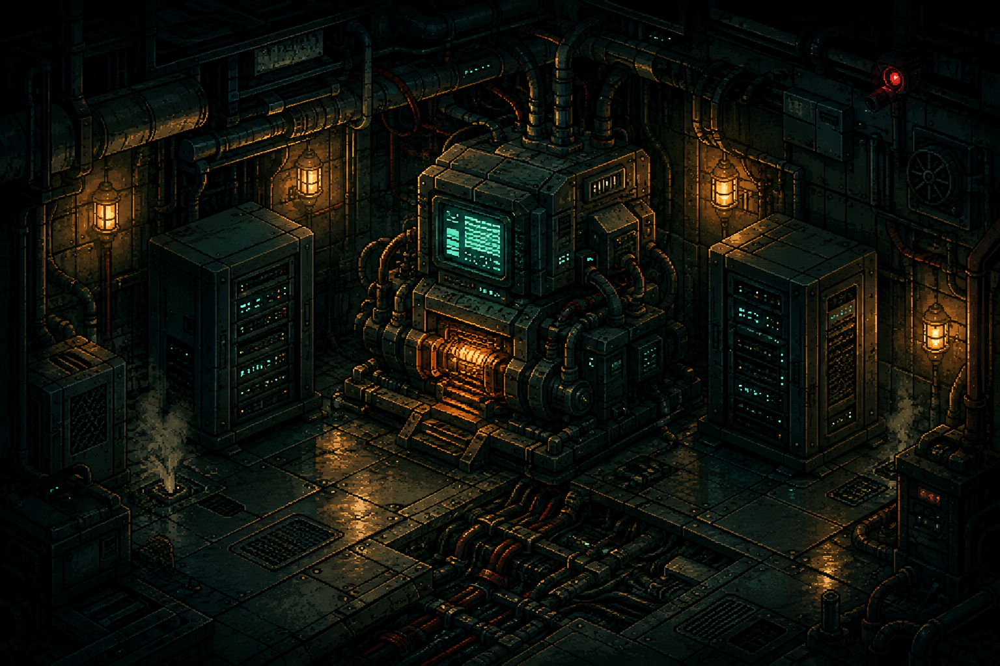

# Risk_V2 — Blacksite Relay

**The full game. Free to play. Open source under GPLv3.**

A compact cyberpunk hacking roguelike: take a risk, build your multiplier, and get
your money out before the trace catches you. Permanent upgrades and prestige
bring you back stronger. A living pixel-art relay station keeps you company.

[Download for Windows](https://github.com/b7216309-jpg/Risk_V2/releases/latest) ·
[Website and trailer / Site et bande-annonce](https://blacksite-relay.b7216309.chatgpt.site) ·
[License](LICENSE)



**Version 1.8.3 · Windows x64 · English / Français · Offline · 420 × 650 portrait**

- Three hacks, six bonuses, and memory, command-entry and timing mini-games.
- Permanent upgrades, prestige, 34 achievements and hidden discoveries.
- Animated machinery, a technician, two rats, a sleepy cat and a tiny snail.
- Four original Neon music arrangements, paced by time and earned score.
- Independent audio controls, keyboard navigation and reduced-motion options.
- Local saves and records. No account or online leaderboard.

## Play

Download the installer, or extract the **whole portable ZIP** and launch
`Risk_V2.exe`. The complete game is free; this is not a demo. The Windows build is
unsigned. Close the game before updating. Existing saves remain compatible.

Choose **Start Run**, review your upgrades and enter the grid. Hack to earn funds,
then transfer them before detection. Banked money persists; unfinished runs do not
resume after quitting. The **How to play** guide explains the rules.

| Control | Action |
| --- | --- |
| `1`, `2`, `3` | Safe Entry, Standard Hack, Brute Force |
| `Space` | Transfer; stop the sequencer during Bypass |
| `B` | Start a charged Bypass |
| `Q`, `W`, `E`, `R`, `A`, `S` | Six bonuses |
| `Tab`, `Shift+Tab`, `Enter` | Keyboard navigation |
| Arrow keys, `Enter` / `Space` | Memory mini-game selection |
| `Escape` | Back, close overlays, skip intro |

## En français

**Le jeu complet est gratuit et son code est libre sous GPLv3.** Téléchargez
l'installateur Windows ou décompressez entièrement la version portable, puis
lancez `Risk_V2.exe`. Changez la langue dans **Settings → Language → Français**.
L'interface, le guide, les succès et les mini-jeux sont traduits.

Piratez, poussez votre multiplicateur, puis transférez avant de vous faire repérer.
Vos améliorations et records restent sur votre PC. Aucune inscription ni connexion
n'est nécessaire pour jouer.

## Run and build from source

Use **Node.js 24 LTS** and npm on Windows. The lockfile pins tested dependencies.

```sh
npm ci
npm start
npm test
npm run test:ui
npm run build
```

Installation needs internet access for Electron and development tools. Playing
does not. If npm asks about dependency install scripts, Electron needs its runtime;
FFmpeg is only needed for media authoring. Do not run the game as administrator.

`build` creates the installer and `dist/win-unpacked/`. `build:dir` creates only
the unpacked app. The portable ZIP contains that entire directory, including notices.
Tests use isolated saves. `test:ui` may display an Electron test window and writes
evidence to `dist/qa/`; set `RISK_V2_EXECUTABLE` to check a packaged executable.

## Modify the game

`renderer.js` owns gameplay. `src/presentation.js` sends read-only snapshots and
resolved events to scene/UI/audio modules; decoration never consumes gameplay
randomness. `main.js` and `preload.js` provide the Electron bridge.

`art-source/` contains the editable Blender scene, art prompts, animation exporters,
sound synthesis and Neon soundtrack generator/scores. Install Blender, Python/NumPy
and FFmpeg only to rebuild media. Run `npx playwright install chromium` for browser
authoring tools, or set `PLAYWRIGHT_CHROMIUM_EXECUTABLE` to an installed Chromium.
Earlier production reports are marked with their historical version numbers.

See [CONTRIBUTING.md](CONTRIBUTING.md), [asset credits](ASSET-CREDITS.md),
[asset licensing](ASSET-LICENSE.md) and [release scope](OPEN-SOURCE-RELEASE.md).

## License

Copyright © 2026 b7216309-jpg and contributors. Project code and included
project-owned artwork, music and effects are **GPL-3.0-only**. You may study,
modify and redistribute them, including commercially, under those terms.
Distributed modified versions must provide corresponding source under GPLv3.

Third-party components retain their licenses: [THIRD-PARTY-NOTICES.md](THIRD-PARTY-NOTICES.md).
The project is not affiliated with Blizzard and includes no Blizzard art or audio.
Created by **b7216309-jpg**, with AI-assisted code and original generated artwork.
